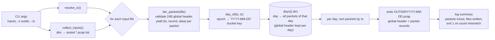

# pcap split-by-day

Splits/merges classic pcap files into **one file per calendar day**
(`YYYY-MM-DD.pcap`), packets sorted by timestamp. Pure Python 3, no
dependencies. Handles microsecond/nanosecond, little/big-endian pcap.

## Usage

```bash
python3 split_pcaps_by_day.py INPUT [INPUT ...] -o OUTDIR [--tz ZONE]

# INPUT  : pcap files and/or directories (dirs are scanned for *.pcap / *.cap)
# -o     : output directory (created if needed)
# --tz   : day-boundary timezone — IANA name (Europe/Amsterdam), UTC (default), or LOCAL
```

```bash
python3 split_pcaps_by_day.py pcaps/ -o pcaps_by_day/
python3 split_pcaps_by_day.py a.pcap b.pcap -o out/ --tz Europe/Amsterdam
```

## Pipeline flow



ASCII version:

```
CLI args (files/dirs, -o OUTDIR, --tz)
        │
        ▼
collect_inputs() ── dirs expanded to sorted *.pcap list
        │
        ▼
for each pcap file ──► iter_packets() ──► validates pcap magic/header,
        │                                    yields one (ts, raw record, raw bytes) per packet
        ▼
day_of(ts, tz) ──► each packet bucketed into days['YYYY-MM-DD']
        │
        ▼
per day: sort packets by timestamp
        │
        ▼
write OUTDIR/YYYY-MM-DD.pcap  (pcap global header + all records of that day)
        │
        ▼
summary log + packet-count check (in == out)
```

Example run (this repo's `pcaps/`): 3 input files, all on 2026-06-01 →
one output `pcaps_by_day/2026-06-01.pcap` with 10,916 packets.

## pcap binary layout (what iter_packets reads)

```
global header (24 bytes): magic(4) ver_major(2) ver_minor(2) thiszone(4) sigfigs(4) snaplen(4) linktype(4)
then, per packet:
  record header (16 bytes): ts_sec(4) ts_frac(4) incl_len(4) orig_len(4)
  packet data: incl_len bytes
```

## Function reference

| Function | What it does |
|---|---|
| `iter_packets(path)` | Generator. Opens one pcap, validates the 24-byte global header (rejects pcapng / non-pcap), then loops: read 16-byte record header → read `incl_len` payload bytes → yield `(ts_float, raw_record_header, raw_packet_bytes, global_header)`. Warns and stops on a truncated trailing packet. |
| `resolve_tz(name)` | Maps the `--tz` value to a tzinfo object: `UTC` → `timezone.utc`, `LOCAL` → `None` (system local time), otherwise `zoneinfo.ZoneInfo(name)`. Exits with a clear error for unknown zones. |
| `day_of(ts, tz)` | Converts a packet timestamp (epoch seconds, float) to a datetime in the chosen timezone and returns the ISO date string — the bucket key for `days{}`. |
| `collect_inputs(args)` | Expands CLI inputs into a flat file list: directories are scanned (sorted) for `*.pcap`/`*.cap`, plain files are kept as-is, anything else is skipped with a warning. |
| `main()` | Orchestrates the run: parse args → resolve tz → collect inputs → `os.makedirs(outdir)` → for every file, bucket each packet into `days[day]` (keeps the first-seen pcap global header per day, warns on header mismatch) while logging per-file packet counts/time ranges → for each day in sorted order, sort packets by timestamp and write `OUTDIR/YYYY-MM-DD.pcap` → print summary and exit 1 if packet counts don't match. |
| `if __name__ == '__main__': main()` | Standard entry-point guard so the module can also be imported without running. |

Constants: `PCAP_MAGICS` maps the 4-byte magic to `(struct endian prefix, timestamp divisor)` for µs/ns × LE/BE; `PCAPNG_MAGIC` is used to detect and reject pcapng.
